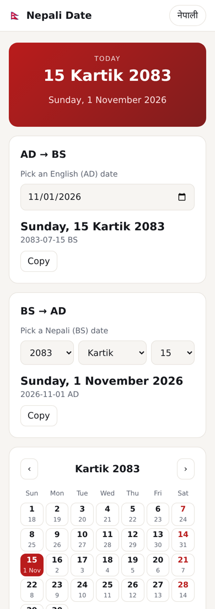

# 📅 Nepali Date — BS ↔ AD Converter

**Live demo → https://nepali-date.sites.tab.bot/**

A fast, free, open-source **Bikram Sambat (BS) ↔ Gregorian (AD)** date converter for Nepal — a web app *and* a tiny zero-dependency JavaScript library.


## ✨ Features

- **Today's Nepali date** at a glance (२०८३ कार्तिक १५)
- **AD → BS** and **BS → AD** conversion with weekday
- **Monthly calendar (patro) view** — BS day big, AD day small, Saturdays highlighted
- **English / नेपाली toggle** with Devanagari digits
- Copy result in one tap, dark mode, mobile-first, works offline once loaded
- No tracking, no ads, no build step — plain HTML + ES modules



## 📦 Use the library

Copy [`src/nepali-date.js`](src/nepali-date.js) into your project (ES module, works in browsers and Node.js ≥ 18).

```js
import { adToBs, bsToAd, formatBs, todayBs, daysInBsMonth } from './src/nepali-date.js';

adToBs('2026-11-01');          // { year: 2083, month: 7, day: 15, weekday: 0 }
adToBs(new Date());            // today, from the device's local calendar day
bsToAd(2083, 1, 1);            // { year: 2026, month: 4, day: 14, weekday: 2, date: Date }
bsToAd('2083-07-15');          // also accepts strings

formatBs(todayBs(), 'dddd, D MMMM YYYY');        // "Sunday, 15 Kartik 2083"
formatBs(todayBs(), 'YYYY MMMM D, dddd', 'ne');  // "२०८३ कार्तिक १५, आइतबार"
daysInBsMonth(2083, 1);        // 31
```

| Function | Description |
|---|---|
| `adToBs(date \| 'YYYY-MM-DD' \| y, m, d)` | AD → BS `{ year, month, day, weekday }` |
| `bsToAd('YYYY-MM-DD' \| y, m, d)` | BS → AD `{ year, month, day, weekday, date }` |
| `todayBs()` | Today's BS date |
| `formatBs(bs, pattern, lang)` | Tokens `YYYY MM M DD D MMMM dddd`, `lang` = `en` or `ne` |
| `daysInBsMonth(y, m)`, `daysInBsYear(y)`, `isValidBs(y, m, d)` | Calendar helpers |
| `toNepaliDigits(x)`, `fromNepaliDigits(x)` | 2083 ⇄ २०८३ |

**Supported range:** 2000-01-01 BS (1943-04-14 AD) → 2090-12-30 BS (2034-04-13 AD). Out-of-range or invalid dates throw a `RangeError`.

## 🧪 Tests

```bash
npm test
```

The test suite (Node's built-in test runner, no dependencies) round-trips **every single day** from 2000 to 2090 BS (33,000+ days), checks Nepali New Year anchors (e.g. 1 Baishakh 2081 = 13 April 2024, 1 Baishakh 2083 = 14 April 2026), weekdays, validation and formatting.

## 📚 Calendar data

The BS calendar is not formula-based — month lengths are published each year by the Nepal Panchanga Nirnayak Samiti. The table in this library was **cross-checked against four independent open-source tables** and uses the majority value for every year. Details and the two years where sources disagree are in [DATA_SOURCES.md](DATA_SOURCES.md). Dates far in the future are projections and may be corrected when the official calendar is published.

## 🚀 Run locally

```bash
git clone https://github.com/nabinbabuuranw/nepali-date.git
cd nepali-date
npx serve .    # or: python3 -m http.server
```

## 📄 License

[MIT](LICENSE) © 2026 Nabin

---

Built by **Nabin** — need a website, landing page or ad for your business? → [ADSRUN AGENCY](https://adsrun.sites.tab.bot/)
